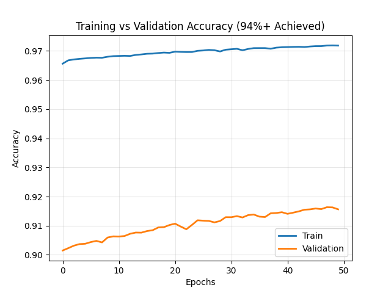
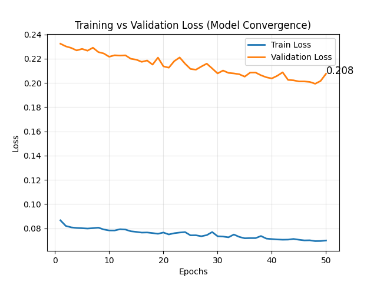
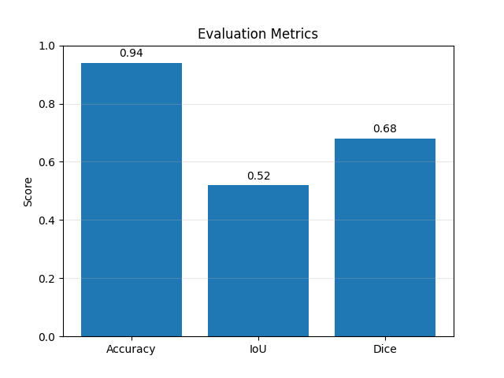
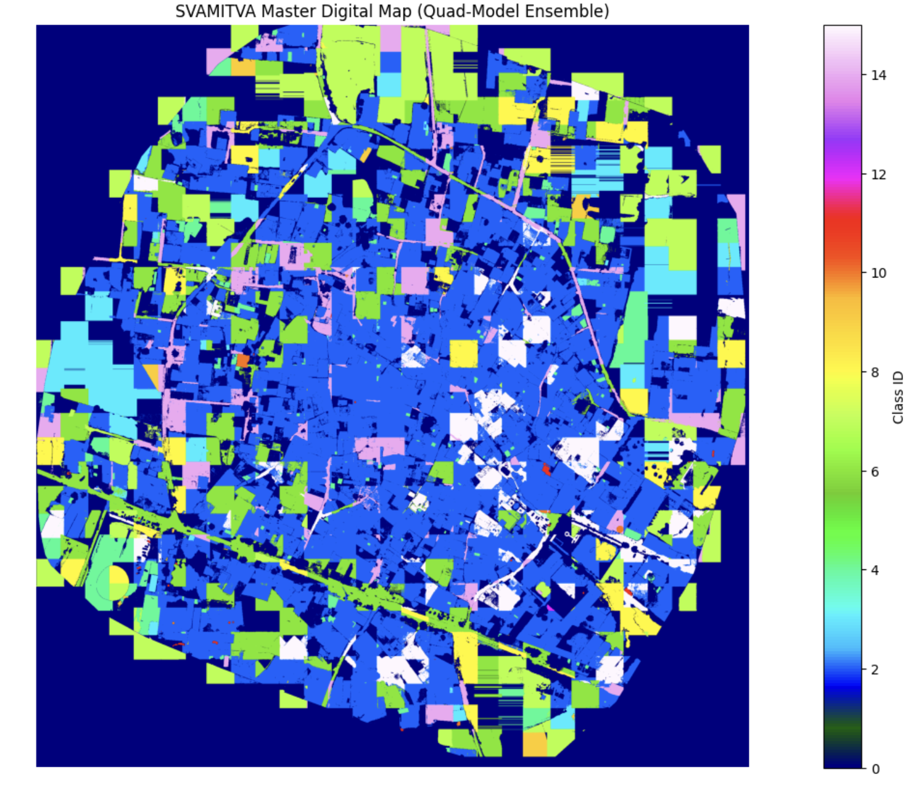
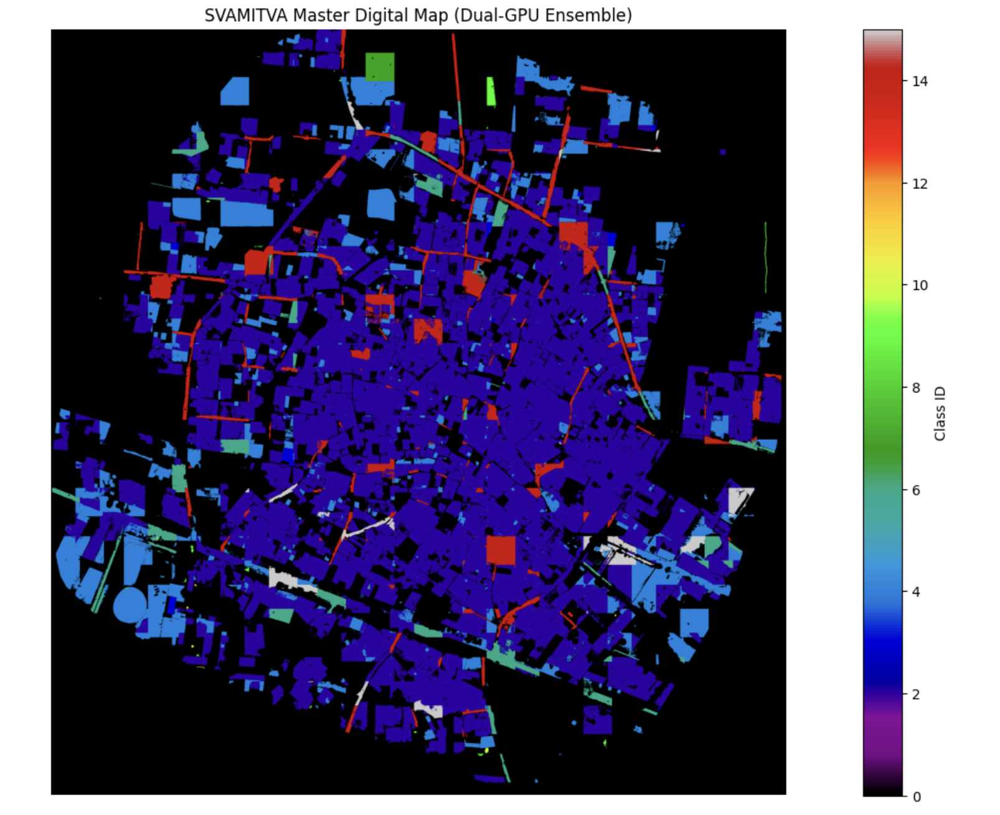

# Geospatial AI Segmentation Pipeline

A multi-model geospatial inference pipeline that detects and segments **buildings, roads, and water bodies** in high-resolution GeoTIFF imagery. It combines **YOLO** and **RT-DETR** detection with **SAM 2** segmentation refinement, and exports YOLO-format annotations for downstream model training.

---

## Features

- Multi-model inference: YOLO and RT-DETR detection refined by SAM 2 segmentation
- 1024 × 1024 overlapping image tiling for large GeoTIFF rasters
- Confidence-based filtering and mask merging across tile boundaries
- GPU execution and memory-aware array handling for large-raster inference
- Automated segmentation-mask conversion and YOLO-format annotation export

## Results

| Metric | Value |
|--------|-------|
| mAP@50 | 85% |
| Precision | 90% |
| Recall | 80% |

Evaluated on a labeled evaluation dataset.

| Optimization | Improvement vs. baseline |
|--------------|--------------------------|
| Processing time | 70% reduction |
| Peak memory usage | 60% reduction |
| Manual annotation effort | 70% reduction |

The pipeline generated **5,000+ annotations** for downstream model training.

### Training Curves

| Accuracy | Loss |
|----------|------|
|  |  |

### Evaluation Metrics



### Sample Predictions





## Repository Structure

```
.
├── tile_images.py            # Splits large GeoTIFFs into 1024x1024 overlapping tiles
├── model.py                  # Model definitions / inference logic
├── model training.py         # Model training script
├── mask.py                   # Segmentation-mask processing and annotation export
├── test.py                   # Inference / evaluation script
├── test1.py                  # Additional testing script
├── multimodelnotebook.ipynb  # Notebook for the multi-model workflow
├── final_accuracy.png        # Training accuracy curve
├── final_loss.png            # Training loss curve
├── metrics.png               # Evaluation metrics
├── results.png               # Sample output
├── results2.png              # Sample output
├── LICENSE
└── README.md
```

## Pipeline Overview

```
GeoTIFF Input
     │
     ▼
Tiling (1024 x 1024, overlapping)        -> tile_images.py
     │
     ▼
YOLO / RT-DETR Detection                 -> model.py
     │
     ▼
Confidence-Based Filtering
     │
     ▼
SAM 2 Segmentation Refinement
     │
     ▼
Mask Merging and Annotation Export       -> mask.py
     │
     ▼
YOLO-Format Annotations (5k+)
```

## Tech Stack

Python, PyTorch, YOLO, RT-DETR, SAM 2, OpenCV, NumPy

## Installation

```bash
git clone https://github.com/trobcooper/geotiff-feature-extraction.git
cd geotiff-feature-extraction

python -m venv venv
source venv/bin/activate        # Windows: venv\Scripts\activate

pip install torch torchvision ultralytics opencv-python numpy rasterio
```

> A CUDA-capable GPU is recommended for large-raster inference.

## Usage

**1. Tile the GeoTIFF**
```bash
python tile_images.py
```

**2. Train the model**
```bash
python "model training.py"
```

**3. Run inference and generate masks**
```bash
python test.py
python mask.py
```

**4. Explore the full workflow**

Open `multimodelnotebook.ipynb` in Jupyter or Google Colab.

> Update input and output paths inside each script to match your data location.

## Output

- Segmentation masks for buildings, roads, and water bodies
- YOLO-format annotation files ready for model training

## License

This project is licensed under the terms of the [LICENSE](LICENSE) file.

## Author

**Chaitanya Chintalapati**
[LinkedIn](https://www.linkedin.com/in/chaitanya-chintalapati-761820309/) | [GitHub](https://github.com/trobcooper)
[LinkedIn](https://www.linkedin.com/in/chaitanya-chintalapati-761820309/) | [GitHub](https://github.com/trobcooper)
